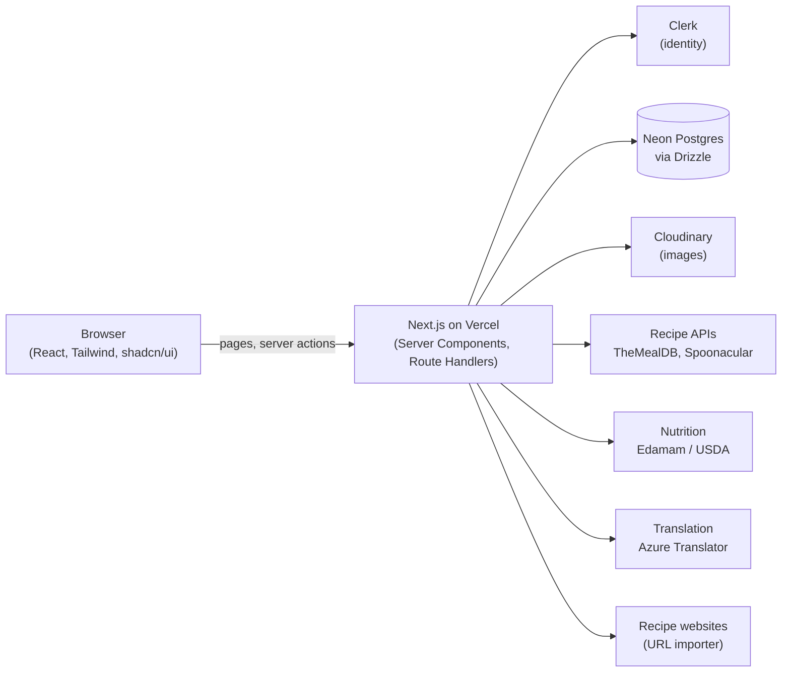
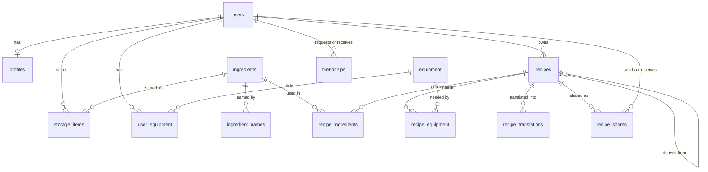

# Technical Documentation

Status: **draft for review.** This document describes how whatisfordinner is built. What is built and when is in [Development_plan.md](Development_plan.md); later ideas are in [Roadmap.md](Roadmap.md).

**How to read this document.** Each section is marked:

- **Implemented** — exists in the repository today.
- **Planned** — decided, not yet built or installed. Check `package.json` before relying on it.
- **Open** — not decided yet (also listed in [section 15](#15-open-decisions)).

Free-tier limits and third-party terms change. Figures below are noted as _unverified_ where they come from memory or secondary sources; check the provider's current page before depending on them.

## 1. Stack

| Area            | Choice                                                            | Status      |
| --------------- | ----------------------------------------------------------------- | ----------- |
| Framework       | Next.js 16.4 (App Router), React 19.3, TypeScript (strict)        | Implemented |
| Styling         | Tailwind CSS 4.3                                                  | Implemented |
| Package manager | pnpm 12                                                           | Implemented |
| Tests           | Vitest 5 + React Testing Library + jest-dom + user-event          | Implemented |
| Quality gates   | ESLint, Prettier, Husky, lint-staged, commitlint                  | Implemented |
| Code review     | CodeRabbit                                                        | In use      |
| UI              | shadcn/ui, plus restyled blocks from third-party shadcn libraries | Planned     |
| Auth            | Clerk                                                             | Planned     |
| Database        | Postgres on Neon, Drizzle ORM                                     | Planned     |
| Validation      | Zod, React Hook Form                                              | Planned     |
| i18n            | `next-intl` (`en-US`, `bg`)                                       | Planned     |
| Images          | Cloudinary                                                        | Planned     |
| HTML parsing    | `cheerio`                                                         | Planned     |
| Recipe types    | `schema-dts` (schema.org `Recipe`)                                | Planned     |
| Hosting         | Vercel (Hobby plan), Neon, Cloudinary                             | Planned     |

Next.js 16 differs from earlier versions (for example, `params` is a Promise and `middleware` was renamed `proxy`). Always read `node_modules/next/dist/docs/` before writing Next.js code.

## 2. Architecture

### 2.1 Overview



### 2.2 Principles

- **Server first.** Pages are Server Components that read data directly. `'use client'` is used only for interactivity, as low in the tree as possible.
- **All external calls are server-side.** Browsers cannot fetch other sites' HTML (CORS) and API keys must stay secret. Route Handlers and Server Actions make every third-party call.
- **Logic in plain functions.** Business rules (importer, matching, ranking) live in `lib/` as pure, unit-testable functions. Actions and handlers stay thin.
- **Every query is scoped by user.** See [section 7](#7-authentication-and-authorization).
- **Providers behind interfaces.** Translation, nutrition and recipe sources each sit behind a small interface so a provider can be swapped when a free tier changes.

### 2.3 Request flow (user-facing mutation)

1. The browser submits a form that calls a Server Action.
2. The action authenticates the user (Clerk), validates input (Zod), and checks ownership.
3. It runs the work in a transaction when more than one write is involved.
4. It revalidates affected paths and returns a typed result: `{ ok: true, data }` or `{ ok: false, error }`.

Webhook requests (for example, Clerk user events) have no user session. They verify the provider's signature instead. See [section 7.3](#73-webhooks).

## 3. Repository layout

Files live at the repository root. There is no `src/` folder, and `@/*` maps to the root.

```text
app/                  routes, layouts, route handlers (App Router)
components/
  ui/                 shadcn/ui only (generated)
  <feature>/          custom components by feature (recipes, kitchen, friends, ...)
hooks/                custom hooks
lib/
  db/                 Drizzle schema, client, queries
  recipes/            importer, parsers, matching, ranking
  providers/          external API clients (recipes, nutrition, translation)
messages/             en.json, bg.json (UI strings)
drizzle/              generated migrations
__tests__/            page and cross-cutting tests (unit tests are co-located)
docs/                 project documentation
.github/              agent instructions, agents, skills
.husky/               git hooks
```

**Implemented today:** `app/`, `__tests__/`, `docs/`, `.github/`, `.husky/` and the config files. The other folders are created as each milestone needs them.

## 4. Development workflow (Implemented)

### 4.1 Commands

| Command                             | Purpose                      |
| ----------------------------------- | ---------------------------- |
| `pnpm dev`                          | Dev server                   |
| `pnpm build` / `pnpm start`         | Production build / serve     |
| `pnpm lint` / `pnpm lint:fix`       | ESLint                       |
| `pnpm format` / `pnpm format:check` | Prettier                     |
| `pnpm typecheck`                    | `tsc --noEmit`               |
| `pnpm test`                         | Vitest in watch mode         |
| `pnpm test:run`                     | Vitest, single run (CI)      |
| `pnpm test:coverage`                | Coverage with 80% thresholds |

Before finishing a change: `pnpm typecheck && pnpm lint && pnpm test:run`.

### 4.2 Git hooks

- `pre-commit`: lint-staged runs ESLint and Prettier on staged files.
- `commit-msg`: commitlint enforces Conventional Commits (`feat`, `fix`, `docs`, `style`, `refactor`, `test`, `chore`, `perf`, `ci`, `build`, `revert`), a lower-case subject, no trailing period, and a header of at most 100 characters.
- Hooks are never bypassed with `--no-verify`.

### 4.3 Versioning and changelog

[Keep a Changelog](https://keepachangelog.com/en/1.0.0/) and [Semantic Versioning](https://semver.org/spec/v2.0.0.html). Sub-headings are unique per version (`Added in 0.0.2`). The version stays the same until a branch is merged; then the version in `docs/CHANGELOG.md` and `package.json` is stepped up together, and the release is tagged with an annotated tag `vx.y.z` (`git tag -a`). Pushing a release pushes the branch and the tag explicitly (`git push origin <branch> vx.y.z`), because `--follow-tags` skips lightweight tags.

### 4.4 Environment variables (Planned)

Real env files are git-ignored. `.env.example` is committed with placeholder values only. Server-only variables never use the `NEXT_PUBLIC_` prefix.

| Variable                                                               | Used for                                         | Scope  |
| ---------------------------------------------------------------------- | ------------------------------------------------ | ------ |
| `DATABASE_URL`                                                         | Neon pooled connection                           | server |
| `DATABASE_URL_UNPOOLED`                                                | Migrations, if Neon requires a direct connection | server |
| `CLERK_SECRET_KEY`                                                     | Clerk server SDK                                 | server |
| `NEXT_PUBLIC_CLERK_PUBLISHABLE_KEY`                                    | Clerk client SDK                                 | public |
| `CLERK_WEBHOOK_SIGNING_SECRET`                                         | Verify Clerk webhooks                            | server |
| `CLOUDINARY_CLOUD_NAME`, `CLOUDINARY_API_KEY`, `CLOUDINARY_API_SECRET` | Image uploads                                    | server |
| `SPOONACULAR_API_KEY`                                                  | Recipe search                                    | server |
| `THEMEALDB_API_KEY`                                                    | Recipe search (free test key is `1`)             | server |
| `EDAMAM_APP_ID`, `EDAMAM_APP_KEY`                                      | Nutrition                                        | server |
| `USDA_API_KEY`                                                         | Nutrition (alternative)                          | server |
| `AZURE_TRANSLATOR_KEY`, `AZURE_TRANSLATOR_REGION`                      | Translation                                      | server |

Exact names are confirmed when each integration is built.

## 5. Testing (Implemented)

- Vitest with jsdom and React Testing Library; `vitest.config.mts` sets `globals: true`, resolves the `@/*` alias, and enforces **80%** thresholds for statements, branches, functions and lines.
- Unit tests are co-located (`Foo.tsx`, `Foo.test.tsx`); page and cross-cutting tests go in `__tests__/`.
- Query by role, label or text; use `userEvent`; mock every external service. Tests never touch the network or a real database.
- **Async Server Components cannot be rendered by Vitest.** Their logic lives in `lib/` and is tested there; whole-page behavior is covered later by end-to-end tests (**Open**: Playwright is the likely choice).
- Excluded from coverage: `components/ui/**` (generated) and `app/layout.tsx` (uses `next/font`).
- Details and templates: [.github/skills/testing/SKILL.md](../.github/skills/testing/SKILL.md).

## 6. Data model (Planned)

Postgres on Neon with Drizzle. Schema is defined in TypeScript (`lib/db/schema.ts`) and changed only through committed migrations (`drizzle-kit generate`). Data can be inspected with Drizzle Studio (`drizzle-kit studio`).

**Conventions:** `uuid` primary keys, `timestamptz` timestamps, `created_at` and `updated_at` on every table, every user-owned table has an indexed `user_id`.

### 6.1 Entity relationships



### 6.2 Tables

**`users`** — mirror of the Clerk account so other tables can use foreign keys.
`id`, `clerk_user_id` (unique), `email`, `display_name`, `locale` (`en-US` or `bg`), timestamps. Created or updated by the Clerk webhook, and lazily on first sign-in as a fallback.

**`profiles`** — one row per user; every field optional.
`user_id` (PK, FK), `diets` (text array), `allergies` (text array), `disliked_ingredient_ids` (uuid array), `liked_ingredient_ids`, `liked_cuisines`, `avoided_methods` (for example `fried`), `preferred_methods`, `spice_level`, `max_prep_minutes`, `max_total_minutes`, `skill_level`, `household_size`, `calorie_goal`, `protein_goal_g`, `carb_goal_g`, `fat_goal_g`, `unit_system` (`metric` or `imperial`). Preferences used for SQL filtering are real columns; anything free-form can go into a `preferences jsonb`.

**`ingredients`** — the canonical ingredient dictionary, shared by all users.
`id`, `key` (unique, for example `chicken-breast`), `category` (produce, dairy, meat, ...), `parent_id` (for example `chicken-breast` → `chicken`), `is_staple` (salt, water, oil, ... assumed to be on hand).

**`ingredient_names`** — every name an ingredient can have, per language.
`ingredient_id`, `locale` (`en` or `bg`), `name`, `is_plural`, `is_synonym`. This table makes matching language-independent: "пилешки гърди", "chicken breast" and "chicken breasts" all resolve to one ingredient.

**`equipment`** — catalog of kitchen tools (oven, stove, grill, air fryer, microwave, mixer, food processor, blender, slow cooker, pressure cooker, ...). `id`, `key` (unique), localized names.
**`user_equipment`** — `user_id`, `equipment_id` (nullable), `custom_name` (for items not in the catalog).

**`storage_items`** — what the user has.
`id`, `user_id`, `location` (`fridge`, `pantry` or `freezer`), `ingredient_id` (nullable until matched), `name` (as entered), `quantity`, `unit`, `expires_on`, `barcode`.

**`recipes`** — one row per recipe in a user's library.
`id`, `user_id`, `data jsonb` (the full schema.org `Recipe`, stored as-is), plus extracted columns for lists and filters: `name`, `language`, `source_url`, `origin` (`own`, `web` or `api`), `favorite`, `image_url`, `image_public_id` (Cloudinary), `prep_minutes`, `cook_minutes`, `total_minutes`, `derived_from_recipe_id` (nullable), timestamps.
Constraint: unique `(user_id, source_url)` where `source_url` is not null, so the same URL is detected as a duplicate per user.
Nutrition is stored in `data.nutrition` (`NutritionInformation`).

**`recipe_ingredients`** — parsed ingredients.
`recipe_id`, `position`, `original_text`, `ingredient_id` (nullable if unmatched), `name`, `quantity`, `unit`, `optional`. Needed because schema.org `recipeIngredient` is free text such as `"2 cups flour, sifted"`, which cannot be matched against a pantry. **This table is the key to "What can I have for dinner?".**

**`recipe_equipment`** — `recipe_id`, `equipment_id`. Filled from the schema.org `tool` field when present, otherwise inferred from instruction text ("preheat the oven"), and editable by the user.

**`recipe_translations`** — `recipe_id`, `locale`, `data jsonb` (translated name, ingredient lines, steps), `is_machine`, `is_edited`, timestamps. The original in `recipes.data` is never overwritten.

**`friendships`** — `id`, `requester_id`, `addressee_id`, `status` (`pending`, `accepted`, `rejected`), timestamps. Unique per user pair (in either direction).

**`recipe_shares`** — `id`, `recipe_id`, `from_user_id`, `to_user_id`, `snapshot jsonb` (the recipe as it was when shared), `saved_recipe_id` (nullable; set when the recipient makes their own copy), `created_at`.

**`api_cache`** — `provider`, `cache_key`, `response jsonb`, `fetched_at`, `expires_at`. Protects free-tier quotas and respects provider caching terms.

### 6.3 Why `jsonb` plus columns

The full schema.org object stays compatible with recipe websites and other tools. Extracted columns keep lists, filters and sorting fast and indexable. The importer and the edit form write both in one transaction so they cannot drift apart.

## 7. Authentication and authorization

### 7.1 Authentication (Planned)

Clerk handles sign-up and sign-in (email and password, magic link or code, social login). `proxy.ts` gates pages (public routes: landing page, sign-in, sign-up, public help, webhooks). Clerk's free tier is 50,000 monthly retained users _(unverified; check Clerk pricing)_, far above what a friends-and-family app needs. User data lives in Clerk, so a local `users` row is kept in sync for foreign keys.

### 7.2 Authorization

- Every **user-facing** Server Action and Route Handler follows the same order: **authenticate → validate (Zod) → authorize → act → revalidate**.
- The proxy alone is never trusted; authentication is checked again in each handler.
- **Ownership authorizes writes.** Every query is scoped by the current user's id; a user id from the client is never trusted.
- **Shared recipes are read-only.** A share gives access to a snapshot. It never authorizes a write to the original or to the share record.
- **Copy on edit.** If a recipient wants to change a shared recipe, the app creates a new `recipes` row owned by the recipient with `derived_from_recipe_id` set, then edits that copy.

### 7.3 Webhooks

Webhook handlers (for example, Clerk user events) have no user session and are exempt from user authentication. They must:

1. Verify the signature on the **raw body** before anything else.
2. Validate the payload with Zod.
3. Process idempotently (providers retry), scoped to the user id in the verified payload.
4. Return 2xx quickly.

Webhook routes are public in `proxy.ts`.

Full rules: [.github/instructions/security.instructions.md](../.github/instructions/security.instructions.md) and [routes.instructions.md](../.github/instructions/routes.instructions.md).

## 8. Key flows (Planned)

### 8.1 URL importer

1. **Validate the URL.** Only `http` and `https`; resolve the host and block private, loopback and link-local addresses (SSRF); limit redirects, response size and time.
2. **Fetch** the page HTML on the server with a clear, browser-like User-Agent.
3. **Parse** with `cheerio`; read every `<script type="application/ld+json">`.
4. **Find the `Recipe`:** top-level object, inside an array, inside `@graph`, or with `@type` as an array such as `["Recipe", "Thing"]`. Resolve `@id` references inside `@graph` (for example `image` and `author`).
5. **Clean up:** decode HTML entities, set `@context` to `https://schema.org`, set `url` to the source URL if missing, and validate the result with Zod.
6. **Copy the image** to Cloudinary (site image URLs change); keep the original URL in the JSON.
7. **Parse ingredients** into `recipe_ingredients` (see 8.2).
8. **Save** the recipe and its ingredients in one transaction. If `(user_id, source_url)` already exists, report a duplicate and offer re-import.

**Known problem:** some sites (for example behind Cloudflare) block server requests. Fallbacks: a "paste page HTML" form that runs steps 3 to 8 on pasted HTML, and later a bookmarklet (see [Roadmap.md](Roadmap.md)). Imported HTML and text are untrusted and are never rendered with `dangerouslySetInnerHTML`.

### 8.2 Ingredient parsing and matching

1. Parse each `recipeIngredient` line into quantity, unit and name (an npm library such as `parse-ingredient`, or Spoonacular's parse endpoint — **Open**).
2. Normalize the name: lower-case, strip quantities, preparation notes ("sifted", "chopped") and plurals.
3. Look it up in `ingredient_names` to find the canonical `ingredient_id`. Unmatched names are kept as text and can be fixed by the user, which also teaches the dictionary.
4. Matching uses the ingredient hierarchy: a pantry item `chicken` can satisfy `chicken-breast` only if the user allows it ("close match"); exact matches rank higher.

The canonical dictionary starts small (common ingredients, English and Bulgarian) and grows over time. Quality of this step decides how good "What can I have for dinner?" feels, so it gets the most test cases.

### 8.3 "What can I have for dinner?"

1. **Input:** ingredient source (fridge and pantry, a custom list, or both) and optional filters (maximum time, diet, equipment). Profile preferences are the defaults and can be turned off per search.
2. **Own library first (SQL):** for each recipe, count required ingredients present in the user's list. Staples (`is_staple`) count as present. Exclude recipes containing allergens or disliked ingredients, recipes over the time limit, and recipes needing equipment the user lacks (or flag them).
3. **Online sources:** TheMealDB and Spoonacular `findByIngredients`, only when requested or when the library has too few good matches. Results are cached in `api_cache`.
4. **Rank** by coverage = `matched required ingredients / total required ingredients`, then by fewest missing ingredients, then by profile preference matches. Each result shows "you have 8 of 10" and the missing items.
5. **Save:** an online result can be saved to the library in one click, turning it into a `recipes` row (`origin = 'api'`).

### 8.4 Sharing and copy on edit

1. Anna sends a friend request; Boris accepts or rejects it (`friendships.status`).
2. Anna shares a recipe with an accepted friend: a `recipe_shares` row stores a **snapshot** of the recipe at that moment.
3. Boris views the snapshot read-only.
4. When Boris saves or edits, a new `recipes` row is created for Boris with `derived_from_recipe_id` pointing at Anna's recipe, and `recipe_shares.saved_recipe_id` is set. Boris edits only his copy.
5. Later edits or deletion of Anna's original do not change Boris's copy or the snapshot. A "the original was updated" notice is a possible later feature.

### 8.5 Translation

1. When a user opens a recipe in a language other than its `language`, the server looks for a matching `recipe_translations` row.
2. If none exists, it translates the name, ingredient lines and steps with the translation provider and stores the result (`is_machine = true`).
3. The UI labels the text as machine translated and lets the user edit it (`is_edited = true`).
4. The first provider is **Azure Translator**, behind a small interface so Google Cloud Translation or DeepL can replace it. The free tier is about 2 million characters per month for Azure, 500,000 for Google and DeepL _(unverified; check each provider)_. A recipe is roughly 2,000 to 3,000 characters.

### 8.6 Nutrition

Nutrition is stored in the schema.org `nutrition` field so it stays standard. Imported recipes keep their own values when present. Otherwise the server calculates it from the ingredient lines with Edamam's Nutrition Analysis API (attribution required) or by summing USDA FoodData Central values (free, more work) — **Open**. Results are cached with the recipe.

### 8.7 Images

Uploads and imported images go to Cloudinary through signed server-side uploads, with type and size validation. The recipe row stores the URL and the Cloudinary public id. Images are shown with `next/image`, and the Cloudinary host is allowed in `next.config.ts`. Cloudinary's free plan uses a shared monthly credit pool for storage, bandwidth and transformations _(unverified; check the Cloudinary billing page)_.

## 9. External services

| Service                   | Purpose                         | Notes                                                                                             |
| ------------------------- | ------------------------------- | ------------------------------------------------------------------------------------------------- |
| Clerk                     | Authentication                  | 50,000 monthly retained users free _(unverified)_; MFA and branding removal are paid              |
| Neon                      | Postgres                        | Free tier with scale to zero and branching; limits _(unverified)_                                 |
| Cloudinary                | Images                          | Free plan with a shared credit pool _(unverified)_                                                |
| TheMealDB                 | Free recipes                    | Free test key; the free tier filters by one ingredient only                                       |
| Spoonacular               | Recipes by ingredients, parsing | Small free quota (about 50 points per day, _unverified_); terms limit how long data may be cached |
| Edamam Nutrition Analysis | Nutrition                       | Free developer tier; attribution required                                                         |
| USDA FoodData Central     | Nutrition (alternative)         | Free with an API key                                                                              |
| Open Food Facts           | Barcode lookup (optional)       | Free, open data                                                                                   |
| Azure Translator          | Machine translation             | Free monthly characters _(unverified)_                                                            |
| Vercel                    | Hosting                         | Hobby plan is for non-commercial use only                                                         |

Rejected: Edamam Meal Planner (meal planning is out of scope) and Edamam Recipe Search (mostly links to the original site without full instructions).

**Licensing:** the app is private, which is acceptable for these terms. Re-check Spoonacular and Edamam terms before opening the app to the public.

**Quota protection:** responses are cached in `api_cache`, searches prefer the user's own library and TheMealDB, usage is logged, and every provider call has a timeout and clear error handling.

## 10. Internationalization (Planned)

- `next-intl` with locales `en-US` (default) and `bg`. Routes live under `app/[locale]/`.
- UI strings are in `messages/en.json` and `messages/bg.json` with identical keys grouped by feature. ICU syntax handles plurals (Bulgarian plural rules differ from English). No hardcoded user-facing strings, including `alt` and `aria-label`.
- A test fails if the two message files have different keys.
- Dates, numbers and units are formatted for the locale; the profile's unit system (metric or imperial) controls recipe quantities.
- Recipe content is not part of the UI messages; see [8.5](#85-translation).
- Details: [.github/instructions/i18n.instructions.md](../.github/instructions/i18n.instructions.md).

## 11. UI and design system (Planned)

- shadcn/ui components in `components/ui/` (generated, never hand-edited); feature components compose them. Borrowed blocks from third-party shadcn libraries are restyled to the app theme and have their strings moved to i18n.
- Design tokens (colors, radius, fonts) are CSS variables so light and dark themes share one set of components.
- Mobile first, WCAG 2.1 AA, rounded shapes, food photography first. Colors and moodboard are decided in milestone M1.
- The help center is a content area with its own layout (sidebar, search, guides) built in milestone M10.
- Component rules: [.github/instructions/components.instructions.md](../.github/instructions/components.instructions.md).

## 12. Security

Summary of the rules in [security.instructions.md](../.github/instructions/security.instructions.md):

- Authentication and ownership are checked in every user-facing handler; shared access is read-only.
- All external input (forms, actions, third-party responses, imported JSON-LD) is validated with Zod.
- URL importer protections: `http` and `https` only, private and loopback addresses blocked, limits on redirects, size and time.
- No `dangerouslySetInnerHTML` with imported or user content; sanitize if rich text is ever needed.
- Secrets only in server environment variables; only `NEXT_PUBLIC_*` reaches the browser.
- Webhook signatures are verified before processing.
- Parameterized queries only (through Drizzle).
- No logging of tokens, passwords or personal data; `pnpm audit` before releases.

## 13. Performance and quotas

- Server Components and streaming (`loading.tsx`) for fast first paint; `next/image` for responsive images.
- Neon scales to zero, so the first request after idle time is slower. Use the pooled connection string and the WebSocket `Pool` driver, which supports transactions. (Neon's HTTP driver does not support interactive transactions.)
- Paginate every list; no unbounded queries or tables.
- Cache third-party results (`api_cache`), translations (`recipe_translations`) and nutrition with the recipe.

## 14. Deployment and operations (Planned)

- **Hosting:** Vercel Hobby for the app, Neon for Postgres, Cloudinary for images.
- **Branches and review:** work on feature branches, review with CodeRabbit, merge to `main`.
- **Release:** after a merge, the changelog version and `package.json` are stepped up together and the commit gets an annotated tag `vx.y.z`; the branch and tag are pushed together explicitly.
- **Migrations:** generated with `drizzle-kit generate`, committed, and applied before deploying code that needs them. Neon branches can be used to test migrations without touching real data.
- **CI:** **Open.** A GitHub Actions workflow running `pnpm typecheck`, `pnpm lint` and `pnpm test:run` on every pull request is recommended.
- **Monitoring:** Vercel logs at first; free-tier usage dashboards for each provider.

## 15. Open decisions

| Decision                         | Options                                           | Needed by                       |
| -------------------------------- | ------------------------------------------------- | ------------------------------- |
| Visual identity (palette, fonts) | To be designed                                    | M1                              |
| Ingredient parsing               | `parse-ingredient` (npm) or Spoonacular endpoint  | M4                              |
| Nutrition source                 | Edamam or USDA FoodData Central                   | M9                              |
| Translation provider             | Azure first; compare Bulgarian quality with DeepL | M9                              |
| End-to-end tests                 | Playwright (likely)                               | When the first full flow exists |
| CI                               | GitHub Actions on pull requests                   | M2                              |
| How friends find each other      | Email only, or also a username                    | M8                              |
| Barcode scanning in v1           | Include or move to the Roadmap                    | M5                              |
| Public help center               | Public and signed-in, or signed-in only           | M10                             |

## 16. Related documents

- [Development_plan.md](Development_plan.md) — scope, milestones, risks
- [Roadmap.md](Roadmap.md) — ideas beyond version 1
- [CHANGELOG.md](CHANGELOG.md) — release history
- [AGENTS.md](../AGENTS.md) — rules for AI agents working in this repository
